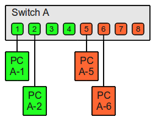
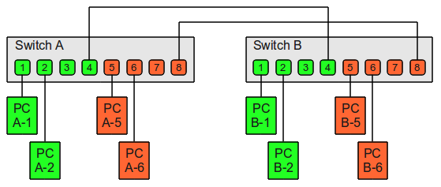
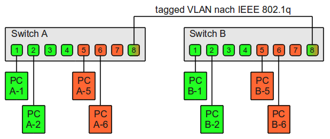
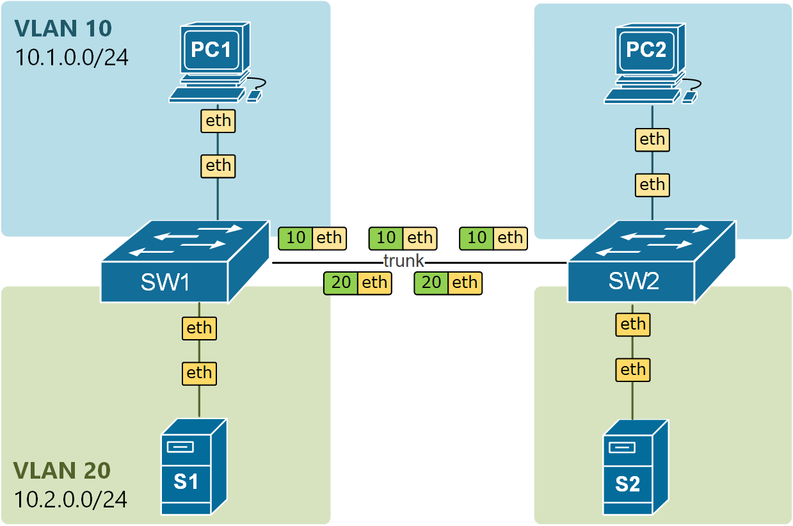

# VLANs

Давайте вспомним основные принципы коммутации. Коммутатор принимает кадр, извлекает из заголовка DST MAC адрес, ищет его в таблице коммутации (таблице MAC адресов), если находит, то пересылает в конкретный интерфейс, если не находит - во все интерфейсы, кроме того, на котором он был получен. Аналогично коммутатор поступает, когда получает кадр с широковещательным DST MAC адресом. 

Это означает, что все устройства, подключенные к одному коммутатору (или набору связанных коммутаторов), находятся в одном широковещательном домене. А значит слышат широковещательный трафик друг друга и могут получить друг к другу прямой доступ. 

Теперь представьте, что у вас есть коммутатор, к которому подключены парочка компьютеров из бухгалтерии, десяток компьютеров в учебном классе, несколько компьютеров в учительской, и ещё пару портов выделены под гостевую сеть.

Все 4 группы устройств находятся в разных IP сетях и в норме взаимодействуют друг с другом только через маршрутизатор, на маршрутизаторе скорее всего настроена фильтрация списками доступа в соответствии с нашими внутренними политиками маршрутизации. Но тем не менее, устройства в разных группах слышат широковещательный трафик друг друга, например ARP запросы. И это плохо, во-первых, потому что устройствам приходится обрабатывать лишний трафик, который для них не предназначен, а во-вторых, это значит, что устройства могут взаимодействовать друг с другом напрямую, в обход маршрутизатора и в обход политик фильтрации.

Первое, что мы могли бы сделать, это выделить под каждую группу устройств свой отдельный коммутатор. И каждый коммутатор подключить в свой порт на маршрутизаторе. В целом, так мы до этого в лабораторной работе и делали. Но такой вариант плохо масштабируется и к тому же затратен. В бухгалтерии у нас всего 2 ПК, под гостевую сеть тоже много интерфейсов не надо, и даже 10 ПК в классе - это не очень много. Таким образом большая часть интерфейсов на коммутаторах будет просто простаивать. Да и если вспомнить про маршрутизаторы, то на них обычно не так уж и много интерфейсов, на все коммутаторы едва хватит.

Альтернативным и более "экологичным" решением было бы разделить порты в рамках одного коммутатора на отдельные изолированные группы. Порты в одной группе будут работать, будто они являются отдельным физическим коммутатором. Кадры, пришедшие на один из портов в группе (неважно уникастовые или бродкастовые), могут быть отправлены **только** на другой порт из этой же группы, но ни как не на порт из другой группы. 

Такие изолированные друг от друга группы называются VLAN'ами. VLAN (Virtual Local Area Network) — это технология логического разделения одной физической локальной сети на несколько виртуальных изолированных сегментов. Устройства в разных VLAN не видят друг друга на канальном уровне (L2), даже если подключены к одному коммутатору. За каждым VLAN'ом закрепляется свой уникальный (в пределах нашей локальной сети) номер, а таблицу MAC-адресов добавляется ещё один столбец с номером VLAN'а и при поиске поры MAC-адрес\порт теперь будет проверяться, к какому VLAN'у принадлежит порт, с которого пришёл кадр.

Пока что VLAN'ы существуют только в пределах нашего одного коммутатора, но было не плохо дать им выбраться наружу. Представьте, что вы расширяете свою сеть. Покупаете ещё один коммутатор, настраиваете на нём VLAN и само собой подразумевается, что вы хотите, чтобы устройства подключенные к одному и тому же VLANу могли бы друг с другом взаимодействовать. Значит вам нужно соединить между собой коммутаторы, а поскольку порт может передавать только трафик того VLAN'а, к которому он относиться, то решением в лоб было соединить коммутаторы отдельным патчем под каждый VLAN. 

Очевидно, что решение в лоб никуда не годится. VLANов может быть сильно больше двух, под каждый выделять свой отдельный порт - никаких портов не хватит. Вместо этого мы будем использовать порты, которые будут принадлежать к нескольким VLAN'ам сразу, называть такие порты мы будет магистральными. А чтобы не запутаться, в какой VLAN помещать принятые кадры, перед отправкой, магистральный порт будет добавлять к ним специальную метку, в которой будет записан номер VLANна, к которому принадлежит этого кадр. 

Таким образом все порты на коммутаторе делятся на два вида:
- Access-порт (порт доступа) - Порт коммутатора, назначенный в один конкретный VLAN. Трафик на access-порту передаётся без тегов - конечное устройство не знает о существовании VLAN. Коммутатор добавляет тег при приёме кадра от устройства и снимает тег при отправке кадра на устройство.
- Trunk-порт (магистральный порт) - Порт коммутатора, сконфигурированный для передачи тегированного трафика нескольких VLAN одновременно. Каждый Ethernet-кадр, проходящий через trunk, содержит тег с идентификатором VLAN. 

Access-порт смотрит в сторону конечного устройства — ПК, принтера, IP-камеры — и принадлежит ровно одному VLAN. Устройство за этим портом вообще не подозревает о существовании VLAN: оно отправляет и получает обычные нетегированные кадры Ethernet, а вся работа с тегами происходит уже внутри коммутатора, прежде чем кадр уйдёт в сторону trunk-линка. Это принципиально важно: VLAN — концепция инфраструктуры, а не конечных устройств, и обычная сетевая карта ПК понятия не имеет, в каком VLAN она работает. Trunk-порт соединяет коммутаторы друг с другом (или коммутатор с роутером, или коммутатор с виртуализационным хостом, на котором крутится несколько VLAN сразу) и пропускает трафик нескольких VLAN одновременно по одному физическому линку. 

## 802.1Q

Теперь осталось разобраться откуда берутся номера vlan'ов и как выглядят метки. Всё, что касается VLAN'ов определяется стандартом IEEE 802.1q. 

802.1q определяет номера VLAN-ов в диапазоне от 0 до 4095. Номера 0 и 4095 зарезервированы и для пользовательского трафика не используются, так что всего существует 4094 номера, с 1 по 4094. 

Стандартный Ethernet-кадр состоит из 6 байт адреса назначения, 6 байт адреса источника, 2 байт поля тип и 46-1500 байт полезных данных. При передаче кадра через Trunk-порт стандарт 802.1q вставляет между адресом отправителя и полем Type 4-байтный Tag, несущий в себе номер VLAN.

Tag состоит из следующих полей:
- TPID (Tag Protocol Identifier) - 16-битное поле, указывающее какой протокол используется для тегирования. Для 802.1q - 0x8100.
- TCI (Tag Control Information) - Также 16 бит, содержит в себе следующие поля:
  - PCP (Priority code point) - 3 бита для задания приоритета передаваемого трафика. 
  - DEI/CFI - 1 бит. Служебный флаг, сейчас его значение нас не интересует.
  - VID (VLAN Identifier) - 12 бит под номер VLAN'а. Отсюда диапазон возможных номеров - от 0 до 4096.

Заметьте, что 802.1q Tag добавляет к заголовку Ethernet дополнительные 4 байта, таким образом добавление тэга увеличивает максимальный размер кадра с 1514 байт (если считать без FCS) до 1518 байт. MTU при этом остаётся прежним, то есть в один кадр всё ещё помещается максимум 1500 байт полезных данных.

## Native VLAN

В контексте обсуждения темы VLAN нельзя обойти стороной такую тему как Native VLAN, он же родной VLAN. Тема Native VLAN касается магистральных портов, но начать стоит с портов доступа.

Access порты назначены конкретному VLAN'у и ожидается, что приходить на них должны кадры без меток. Как в таком случае должен поступить Access-порт, если получит кадр с меткой? В абсолютном большинстве случаев коммутатор отбросит его, хотя некоторые производители, если метка совпадает с номером VLAN, назначенным порту, позволяют принять такой кадр. 

Trunk-порты порты наоборот работают с многими VLAN'ами сразу и ожидают, что кадры будут приходить с метками. Как тогда поступит Trunk-порт, если получит кадр без метки? По аналогии с Access портами можно было бы сказать, что он должен его отбросить, но вот как раз таки нет. 

В стандарте 802.1Q описано, что когда на Trunk-порт приходит нетэгированный кадр, то он должен быть помещен в VLAN который является Native VLAN'он для данного интерфейса. И наоборот, при передаче через Trunk кадра Native VLAN'а - кадр передаётся без тэга.

Native VLAN на интерфейсах одного коммутатора могут отличаться, но обязаны совпадать с обеих сторон канала. Если trunk получит кадр, тэгированный номером своего Native VLAN, то он его отбросит. 

Допустим на двух Trunk'ах (Порт1 и Порт2) коммутатора настроен одинаковый Native VLAN, например, VLAN10. Порт1 получив нетэгированный кадр поместит его в VLAN10, если коммутатор решит переслать кадр через Порт2, то перед отправкой с него будет снят тэг. 

Если на двух портах из примера выше будут настроены разные Native VLAN (например 10 на Порт1 и 20 на Порт2), в таком случае Порт1 также поместит кадр без тэга во влан 10, но через Порт2 кадр будет отправлен уже с тэгом. Кадр с тэгом 10, пришедший на Порт2, будет передан через Порт1 без тэга.

## Inter-VLAN routing 

Мы добились чего хотели, устройства изолированы друг от друга на L2. Не видят друг друга напрямую, даже если подключены в два соседних порта на коммутаторе. Чтобы трафик мог переходить из одного VLAN в другой, нужен узел уровня L3: он же наш любимый роутер. 

Первое решение для маршрутизации между VLAN - это подключить маршрутизатор отдельным интерфейсом в каждый VLAN. Понятное дело, что реальных сетях такое использовать невозможно. Портов на роутере не хватит.

### Router-on-a-Stick

Второй метод, метод, который реально используется для маршрутизации между VLAN - «router-on-a-stick» или "роутер на палочке". Иногда ещё его называют "lollipop". Этот метод позволяет использовать для маршрутизации между несколькими VLAN только один физический интерфейс. 

Интерфейс маршрутизатора подключается к Trunk-порту коммутатора. Затем на физическом интерфейсе маршрутизатора настраиваются программные **сабинтерфейсы**, по одному на каждый VLAN. Каждому **сабинтерфейсу** отдельно назначается IP адрес и маска из соответствующей подсети. 

Когда на интерфейс роутера приходит трафик с тэгом VLAN, он перенаправляется на соответствующий сабинтерфейс. После принятия решения о маршрутизации на основе IP-адреса назначения маршрутизатор определяет выходной интерфейс. Если выходной интерфейс настроен как сабинтерфейс, то кадры помечаются новой меткой VLAN и отправляются обратно на физический интерфейс.

